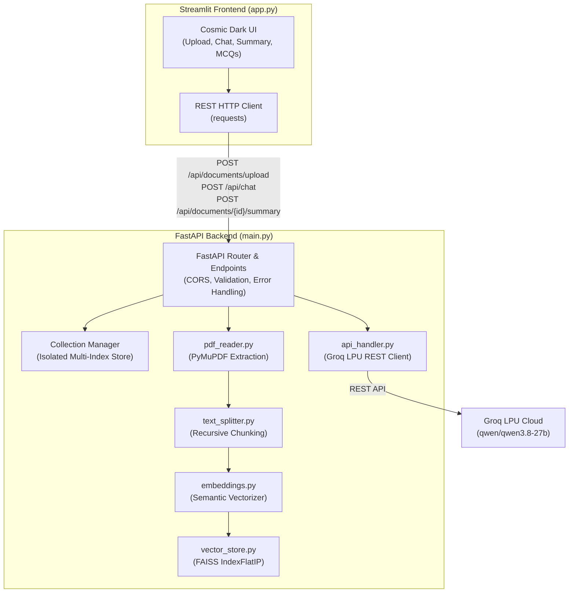

# 📚 DocuVerse AI – Intelligent Document Reading & Q&A System

A production-ready **Retrieval-Augmented Generation (RAG)** system featuring a high-performance **FastAPI backend** and an interactive **Streamlit frontend**. Powered by **PyMuPDF, FAISS vector indexing, and Groq LPU** (`qwen/qwen3.8-27b`), DocuVerse AI enables users to upload PDF documents and receive strictly document-grounded answers with exact page citations, executive summaries, practice MCQs, and key takeaways in English, Hindi, and Hinglish.

---

## 🌟 Key Features

1. **Production-Ready FastAPI Backend**:
   - Clean RESTful endpoints for document ingestion, collection management, semantic Q&A, summaries, and MCQs.
   - Interactive Swagger API documentation automatically generated at `/docs`.
   - Threadpool offloading (`asyncio.to_thread`) for CPU-bound tasks to prevent event loop blocking.
   - Strict Pydantic v2 data validation and structured responses.
2. **Document Isolation & Multi-Index Management**:
   - Each upload session generates a unique `collection_id`.
   - Dedicated, isolated FAISS vector indexes and metadata stores prevent any cross-document or cross-user data leakage.
3. **Streamlit Cosmic Dark Theme UI**:
   - 100% responsive dark theme optimized for desktop, tablet, and mobile devices.
   - Seamlessly talks to the FastAPI backend over HTTP REST requests.
4. **PyMuPDF Fast Extraction**: High-throughput page-by-page text parsing with zero loss of page reference metadata.
5. **Semantic Overlapping Chunking**: Recursive separator splitting preserves sentence boundaries with contextual continuity.
6. **FAISS Cosine Similarity Search**: Instantaneous mathematical retrieval over normalized embedding vectors.
7. **Ultra-Fast Groq LPU Inference**: Powered by verified Groq cloud models (`qwen/qwen3.8-27b` / `openai/gpt-oss-20b`), generating answers in under 1 second.
8. **Strict Anti-Hallucination & Exact Citations**: AI answers strictly from provided context. If information is missing, it explicitly informs the user. Every citation cites the source filename, exact page number, and text snippet.
9. **Document Intelligence Tools**:
   - 📄 **Executive Summary**: Comprehensive multi-paragraph document overview.
   - 🎯 **Practice MCQs**: Interactive multiple-choice questions with answer keys and explanations.
   - ⭐ **Key Points**: Crisp bulleted takeaways.
10. **Multi-Language Support**: Choose your preferred response language: **English**, **Hinglish**, or **Hindi (हिंदी)**.

---

## 🏛️ System Architecture



---

## 📡 API Endpoints Reference

| Method | Endpoint | Description | Request / Body | Response |
| :--- | :--- | :--- | :--- | :--- |
| `GET` | `/` | Application info and API status | None | `AppInfoResponse` |
| `GET` | `/health` | Backend health check & configuration | None | `HealthResponse` |
| `POST` | `/api/documents/upload` | Upload 1+ PDFs, extract, chunk, & index | `multipart/form-data` (`files`) | `DocumentUploadResponse` (`collection_id`) |
| `POST` | `/api/chat` | Ask questions with exact citations | `ChatRequest` (`collection_id`, `question`, `language`) | `ChatResponse` (`answer`, `sources`) |
| `POST` | `/api/documents/{id}/summary` | Generate executive document summary | `SummaryRequest` (`language`) | `SummaryResponse` |
| `POST` | `/api/documents/{id}/mcqs` | Generate interactive practice MCQs | `MCQRequest` (`num_questions`) | `MCQResponse` |
| `POST` | `/api/documents/{id}/key-points` | Extract core bulleted takeaways | `KeyPointsRequest` (`language`) | `KeyPointsResponse` |
| `DELETE` | `/api/documents/{id}` | Delete collection & free vector index | None | `DeleteCollectionResponse` |
| `GET` | `/api/documents` | List active collections summary | None | List of collections |

Interactive Swagger documentation is available at **`/docs`** and ReDoc at **`/redoc`**.

---

## 📁 Project Structure

```text
DocuVerseAI/
├── main.py                # FastAPI Application & REST Endpoints
├── app.py                 # Streamlit Frontend (Communicates with Backend via REST)
├── config.py              # Central Configuration & Environment Manager
├── pdf_reader.py          # PyMuPDF PDF Text & Page Extraction
├── text_splitter.py       # Semantic Recursive Text Chunker
├── embeddings.py          # Text Embeddings & Semantic Vectorizer
├── vector_store.py        # FAISS Vector Store & Multi-Collection Manager
├── api_handler.py         # Groq LPU REST API Orchestration
├── requirements.txt       # Production Dependencies
├── render.yaml            # Render Blueprint Deployment Configuration
├── test_backend.py        # Automated Pytest Test Suite
├── .env.example           # Environment Variables Template
├── .gitignore             # Git Ignore Rules
└── README.md              # Documentation
```

---

## 💻 Local Setup & Execution

### 1. Clone the Repository
```bash
git clone https://github.com/pankaj2007kumar26-max/DocuVerseAI.git
cd DocuVerseAI
```

### 2. Create and Activate Virtual Environment
```bash
# Windows
python -m venv venv
.\venv\Scripts\Activate.ps1

# Linux / macOS
python3 -m venv venv
source venv/bin/activate
```

### 3. Install Dependencies
```bash
pip install -r requirements.txt
```

### 4. Configure Environment Variables
Copy `.env.example` to `.env`:
```bash
cp .env.example .env
```
Add your free Groq API key:
```env
GROQ_API_KEY=gsk_your_groq_api_key_here
PORT=8000
BACKEND_URL=http://127.0.0.1:8000
```
*(Get a free key at [https://console.groq.com/keys](https://console.groq.com/keys))*

### 5. Run the FastAPI Backend (Terminal 1)
```bash
uvicorn main:app --host 0.0.0.0 --port 8000 --reload
```
API Documentation will be live at: `http://127.0.0.1:8000/docs`.

### 6. Run the Streamlit Frontend (Terminal 2)
```bash
streamlit run app.py
```
Frontend will open automatically at: `http://localhost:8501`.

---

## 🚀 Deployment Instructions

### A. Deploy FastAPI Backend on Render (100% Free)
1. Push this repository to GitHub: `https://github.com/pankaj2007kumar26-max/DocuVerseAI`.
2. Go to [dashboard.render.com](https://dashboard.render.com/) and click **New** -> **Web Service**.
3. Connect your `DocuVerseAI` repository.
4. Set the following settings:
   - **Name:** `docuverse-api`
   - **Runtime:** `Python 3`
   - **Build Command:** `pip install -r requirements.txt`
   - **Start Command:** `uvicorn main:app --host 0.0.0.0 --port $PORT`
5. Under **Environment Variables**, add:
   - `GROQ_API_KEY`: `gsk_your_actual_key`
   - `PYTHON_VERSION`: `3.11.9`
   - `CORS_ORIGINS`: `*`
   - `MAX_FILE_SIZE_MB`: `15`
6. Click **Deploy Web Service**.
7. Once deployed, copy your Render URL (e.g. `https://docuverse-api.onrender.com`).

### B. Deploy Streamlit Frontend on Streamlit Cloud
1. Go to [share.streamlit.io](https://share.streamlit.io/) and click **New app**.
2. Select repository: `pankaj2007kumar26-max/DocuVerseAI`, branch: `main`, file: `app.py`.
3. Under **Advanced settings** -> **Secrets**, add your Render backend URL:
   ```toml
   BACKEND_URL = "https://docuverse-api.onrender.com"
   ```
4. Click **Deploy!**

---

## 🧪 Running Automated Tests

Run the comprehensive pytest test suite to verify all endpoints, collection isolation, citations, and error handling:

```bash
pytest test_backend.py -v
```

---

## 🔒 Security Best Practices
- **Never Commit Secrets**: `.env` is strictly ignored by `.gitignore`.
- **Environment Isolation**: Production environments use deployment platform secrets (Render Environment Variables and Streamlit Secrets).
- **Document Isolation**: Multi-index separation guarantees zero leakage between different upload sessions.

---

## 🎓 Academic Info
- **Project:** B.Tech Mini-Project / AI Study Assistant
- **Author:** Pankaj Kumar ([@pankaj2007kumar26-max](https://github.com/pankaj2007kumar26-max))
- **Tech:** FastAPI, Python, Streamlit, PyMuPDF, FAISS, Groq LPU, RAG
