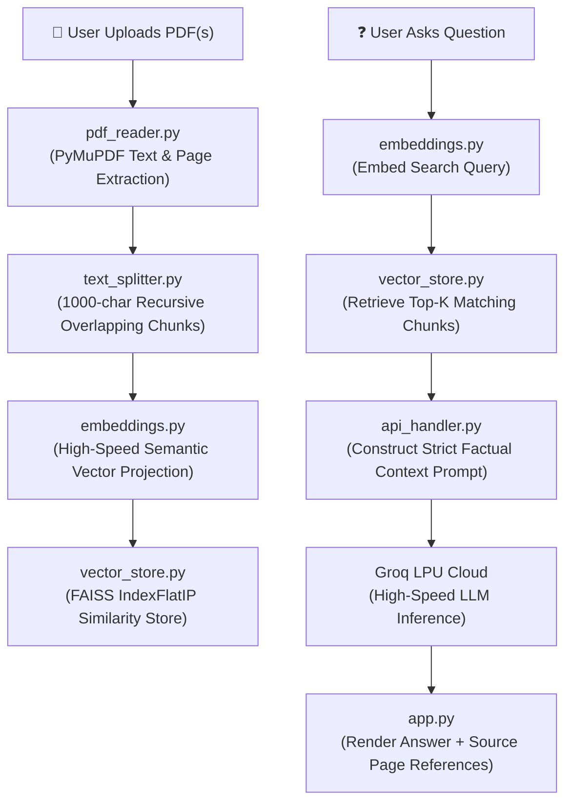

# 📚 DocuVerse AI – Intelligent Document Reading & Question Answering System (PDF Assistant)

An intelligent, production-grade **Retrieval-Augmented Generation (RAG)** application built with **Python, Streamlit, PyMuPDF, FAISS, and Groq LPU**. Upload any PDF document (notes, research papers, resumes, books, reports) and get instant, strictly factual answers with exact page citations, executive summaries, MCQs, and key takeaways in English, Hindi, and Hinglish.

---

## 🌟 Key Features

1. **Multi-PDF Document Ingestion**: Upload one or more PDFs simultaneously. PyMuPDF extracts text and metadata page by page with high throughput.
2. **Semantic Text Chunking**: Recursive separator splitting preserves sentence boundaries and cross-chunk context overlap.
3. **FAISS Vector Indexing**: High-speed cosine similarity search powered by Facebook AI Similarity Search (FAISS).
4. **Groq LPU Powered Inference**: Lightning-fast answers using Groq LPU cloud models (`qwen/qwen3.8-27b` / `openai/gpt-oss-20b`).
5. **Strict Anti-Hallucination**: The AI answers strictly using the uploaded document context. If information is missing, it explicitly informs the user.
6. **Precise Page Citations**: Every answer includes source filename, page number, and relevant text snippet.
7. **Document Intelligence Tools**:
   - 📄 **Executive Summary**: Comprehensive multi-paragraph document overview.
   - 🎯 **Practice MCQs**: Interactive multiple-choice questions with answer keys and explanations.
   - ⭐ **Key Points**: Crisp bulleted takeaways.
8. **Multi-Language Support**: Choose your preferred response language: **English**, **Hinglish**, or **Hindi (हिंदी)**.
9. **Modern Responsive UI**: Clean cosmic dark theme inspired by professional AI study assistants, optimized for desktop, tablet, and mobile displays.

---

## 🏛️ System Architecture



---

## 📁 Project Structure

```text
DocuVerseAI/
├── app.py                 # Main Streamlit UI & Application Flow
├── config.py              # Configuration & Environment Manager
├── pdf_reader.py          # PDF Text & Page Extraction (PyMuPDF)
├── text_splitter.py       # Semantic Text Chunking Engine
├── embeddings.py          # Text Embeddings & Vectorizer Manager
├── vector_store.py        # FAISS Vector Search & Indexing Engine
├── api_handler.py         # Groq LPU REST API Client & Prompt Orchestration
├── requirements.txt       # Project Dependencies
├── .env.example           # Environment Variables Template
├── .gitignore             # Git Ignore Rules (Protects .env and cache)
└── README.md              # Documentation
```

---

## 💻 Local Setup & Installation

### 1. Clone the Repository
```bash
git clone https://github.com/pankaj2007kumar26-max/DocuVerseAI.git
cd DocuVerseAI
```

### 2. Create and Activate Virtual Environment
```bash
# Windows
python -m venv venv
.\venv\Scripts\Activate.ps1

# Linux / macOS
python3 -m venv venv
source venv/bin/activate
```

### 3. Install Dependencies
```bash
pip install -r requirements.txt
```

### 4. Configure Environment Variables
Copy `.env.example` to `.env`:
```bash
cp .env.example .env
```
Open `.env` and add your free Groq API key:
```env
GROQ_API_KEY=gsk_your_groq_api_key_here
```
*(Get a free Groq API key at [https://console.groq.com/keys](https://console.groq.com/keys))*

### 5. Run the Application
```bash
streamlit run app.py
```
Open your browser at `http://localhost:8501`.

---

## 🚀 1-Click Free Deployment on Streamlit Cloud

1. Push this repository to your GitHub account: `pankaj2007kumar26-max/DocuVerseAI`.
2. Visit [share.streamlit.io](https://share.streamlit.io/) and log in with GitHub.
3. Click **"New app"** and select:
   - **Repository:** `pankaj2007kumar26-max/DocuVerseAI`
   - **Branch:** `main`
   - **Main file path:** `app.py`
4. Expand **Advanced settings** -> **Secrets** and paste:
   ```toml
   GROQ_API_KEY = "gsk_your_groq_api_key_here"
   ```
5. Click **"Deploy!"** Your app will be live with a shareable public URL!

---

## 🔒 Security Best Practice
API keys are stored exclusively in local `.env` files or Streamlit Cloud Secrets. They are strictly excluded by `.gitignore` and are never exposed or committed to public version control.

---

## 🎓 Academic Info
- **Project:** B.Tech Mini-Project / AI Study Assistant
- **Author:** Pankaj Kumar ([@pankaj2007kumar26-max](https://github.com/pankaj2007kumar26-max))
- **Tech:** Python, Streamlit, PyMuPDF, FAISS, Groq LPU, RAG
